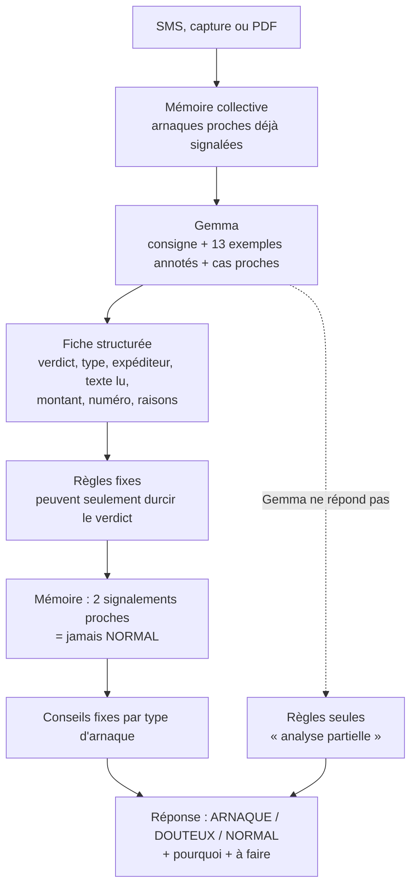
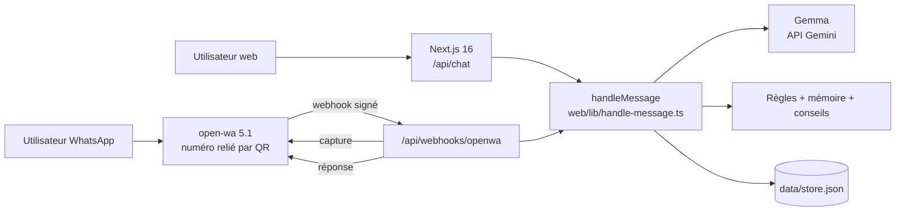

# Alerte Marché

**Le message est-il vrai ?** Un scanner d'arnaques Mobile Money et SMS, propulsé par Gemma, accessible sur le web et sur WhatsApp.

Équipe **les-kernels** — Hackathon « Build with Gemma », Hacktoberfest Hack Day Lomé × LBS CS Club, 31 octobre 2026.

---

## 1. Le problème

Au Togo, le Mobile Money (T-Money, Moov Money / Flooz) est utilisé partout, par tout le monde, y compris par des personnes peu à l'aise avec l'écrit. Les arnaques par SMS sont quotidiennes :

- « J'ai envoyé de l'argent par erreur sur ton numéro, renvoie-le-moi » ;
- faux avis « T-Money » envoyés depuis un numéro de téléphone ;
- faux gains, faux concours, fausses tontines avec « frais de retrait » ;
- codes à taper (`*…#`) qui envoient l'argent à l'escroc ;
- fausses alertes de banque, faux colis, fausses offres d'emploi, faux prêts, faux proches « en urgence ».

La victime n'a que quelques secondes et souvent personne à qui demander. Notre public : **la vendeuse au marché**, l'étudiant, le parent. Il faut une réponse claire, en français simple, là où les gens sont déjà : sur WhatsApp.

## 2. Notre solution

On transfère ou on colle le message suspect, ou on envoie une capture. En quelques secondes, Alerte Marché répond :

```
ARNAQUE — C'est une arnaque. Ne renvoie rien, ne donne aucun code, ne clique sur rien.
Montant lu : 50000 FCFA

Pourquoi :
• On te demande de renvoyer de l'argent. Un vrai dépôt ne se renvoie jamais à un particulier.
• Le message te demande de contacter ou payer un numéro privé.

Un message très proche a déjà été signalé comme arnaque par 4 personnes.

Arnaqueur actif — signalé par 4 personnes en 48 h.

À faire :
• Ne renvoie rien : vérifie ton vrai solde dans ton compte, le dépôt n'existe sans doute pas.
• Un vrai dépôt par erreur se règle par l'opérateur, jamais par un particulier.

Déjà payé ou donné ton code ? Envoie /victime.
```

Trois verdicts seulement, toujours en premier mot : **ARNAQUE**, **DOUTEUX**, **NORMAL**.

## 3. Ce qui nous différencie

| Idée | Pourquoi c'est important |
| --- | --- |
| **Gemma + règles de sécurité** | Gemma comprend le message ; des règles fixes l'empêchent de déclarer « normal » une arnaque évidente. Une règle peut durcir le verdict, jamais l'adoucir. |
| **Gemma apprend par l'exemple** | 13 cas annotés (vrais avis et arnaques typiques du Togo) accompagnent chaque analyse. |
| **Mémoire collective** | Chaque signalement protège les suivants : « déjà signalé par N personnes ». Les arnaques proches sont transmises à Gemma comme contexte. |
| **Mur des numéros** | Un numéro signalé par 4 personnes différentes en 48 h devient « Arnaqueur actif ». Une même personne ne compte qu'une fois. |
| **Conseils écrits par l'équipe** | Les conseils ne sont pas inventés par l'IA : ils sont fixés pour chaque type d'arnaque. `/victime` guide après coup. |
| **WhatsApp d'abord** | Le canal que tout le monde a déjà. Texte, capture d'écran ou PDF. |
| **Au-delà des opérateurs** | Banques, colis, emploi, prêts, faux proches : toutes les arnaques à l'argent par message. |

## 4. Comment l'IA détecte une arnaque



### 4.1 Gemma (`web/lib/gemma.ts`)

Gemma reçoit :
- une consigne qui décrit un vrai avis de transaction : il vient d'un **nom** (TMONEY, MOOV, la banque) et non d'un numéro, il annonce une opération **déjà faite** (montant, solde, référence), et il ne demande **jamais** de renvoyer, d'appeler, de cliquer, de donner un code ou de payer des frais ;
- **13 exemples annotés** (`web/lib/knowledge.ts`), tous fictifs ;
- les **arnaques proches déjà signalées** par d'autres utilisateurs ;
- le message encadré et déclaré comme **donnée**, pour résister aux instructions cachées dans le SMS.

Il renvoie une fiche JSON : verdict, type d'arnaque (12 types), expéditeur, texte recopié depuis la capture, montant, numéro à payer, raisons, suite probable de l'arnaque. Les fautes d'orthographe d'un message qui se dit officiel sont relevées comme indice, sans suffire seules.

### 4.2 Règles de sécurité (`web/lib/rules.ts`)

| Signe trouvé | Verdict minimum |
| --- | --- |
| Demande d'envoyer un code ou un PIN | ARNAQUE |
| « Renvoyez », « retournez », « remboursez » | ARNAQUE |
| Frais à payer pour un gain, un colis, un emploi ou un prêt | ARNAQUE |
| Un lien | ARNAQUE |
| Code `*…#` contenant un numéro de téléphone | ARNAQUE |
| « Proche » avec nouveau numéro qui demande de l'argent | ARNAQUE |
| Message « T-Money / Moov / banque » envoyé depuis un numéro de téléphone | ARNAQUE |
| Demande d'appeler ou de payer un numéro privé | DOUTEUX |
| Gain non demandé, menace de blocage, urgence, code `*…#` | DOUTEUX |

Les règles lisent le texte d'origine **et** le texte que Gemma a recopié depuis une capture.

### 4.3 Mémoire collective (`web/lib/reputation.ts`)

Chaque message est comparé, mot à mot, aux arnaques signalées dans les 30 derniers jours par d'autres personnes. Si une ou plusieurs personnes ont signalé un message très proche, la réponse le dit. À partir de deux, le verdict ne peut plus être NORMAL.

### 4.4 Mode dégradé

Si Gemma ne répond pas (réseau, quota), une arnaque évidente reste signalée par les règles, marquée « analyse partielle ». Sans clé Gemma, le service refuse de fonctionner : **Gemma est indispensable**, comme l'exige le sujet.

## 5. Fonctionnalités

### Scanner
- Texte collé, capture d'écran, photo ou PDF, sur le web et sur WhatsApp.
- Champ « Expéditeur » facultatif sur le web : un « avis T-Money » venant d'un numéro est démasqué.
- Photos réduites dans le navigateur avant l'envoi (1600 px).

### Commandes (actives seulement avec `/`)

| Commande | Rôle |
| --- | --- |
| `/` ou `/menu` | toutes les options |
| `/verifier` | revenir au scanner |
| `/conseils` | les 5 réflexes anti-arnaque |
| `/victime` | quoi faire si on a déjà payé ou donné son code |
| `/apprendre` | mode cours : texte, photo ou PDF (les pages s'ajoutent) |
| `/plan 12 novembre` | plan de révision jusqu'à l'examen, à partir de la date du jour |
| `/quiz` | une question, corrigée ; les notions ratées reviennent |
| `/resume` | fiche de révision |
| `/stop` | retour au scanner |

**Sécurité du volet Apprendre** : même en plein quiz, un message qui ressemble à un SMS d'argent est analysé comme un SMS. Les modes cours se referment seuls après 2 h sans message.

### Pages du site
- `/` : le scanner, les exemples de démo, les boutons « 5 réflexes » et « J'ai déjà payé ».
- `/numeros` : le mur des numéros signalés, avec le regroupement « même arnaque, plusieurs numéros ». Rafraîchi toutes les 10 s.
- `/admin` : état de la session WhatsApp (QR), dernières lectures sans données personnelles.

## 6. Architecture



| Dossier / fichier | Rôle |
| --- | --- |
| `web/lib/handle-message.ts` | cerveau unique : commandes, modes, analyse, réponse |
| `web/lib/gemma.ts` | appels à Gemma (scan, cours, plan, quiz, fiche) |
| `web/lib/rules.ts` | règles de sécurité, mode dégradé, sortie du mode cours |
| `web/lib/knowledge.ts` | exemples annotés, conseils, réflexes, étapes victime |
| `web/lib/reputation.ts` | mur des numéros, mémoire collective |
| `web/lib/store.ts` | stockage JSON à écriture atomique |
| `web/lib/openwa.ts` | envoi WhatsApp, téléchargement des captures, état de session |
| `web/app/api/*` | routes : chat, webhook WhatsApp, numéros, rapports, démo, session |
| `openwa/` | configuration du pont WhatsApp |
| `web/tests/` | 38 tests |

**Stack** : Next.js 16, React 19, TypeScript strict, Tailwind 4, `@google/genai` (Gemma via l'API Gemini), open-wa 5.1, tests `node:test`.

## 7. Sécurité et confidentialité

- **Aucune vraie donnée** : tous les exemples et numéros de démo sont fictifs (`+228 00 00 00 xx`).
- `/api/reports` ne renvoie jamais le numéro WhatsApp d'un utilisateur ni le texte de son message.
- Les sessions web sont séparées des sessions WhatsApp : impossible de lire la conversation d'un autre en changeant un identifiant.
- Webhook WhatsApp protégé par un secret, expéditeur validé (conversations privées seulement, pas de groupes).
- Entrées validées : taille du texte, type et poids des fichiers.
- Écriture atomique des données : un arrêt brutal ne peut plus tout effacer.
- Secrets dans `.env`, jamais commités ; avertissement au démarrage si un secret par défaut est utilisé.

## 8. Qualité

```bash
cd web
npm run typecheck   # TypeScript strict, 0 erreur
npm run lint        # ESLint, 0 erreur
npm test            # 38 tests
```

Les tests couvrent :
- les **13 exemples annotés** rejoués contre les règles : les 9 arnaques finissent rouges même si Gemma dit « normal », et les 4 vrais messages ne déclenchent aucune fausse alerte ;
- la sortie du mode cours quand un SMS d'arnaque arrive ;
- le mur des numéros (une personne compte une fois, fenêtre de 48 h, seuils) ;
- la mémoire collective ;
- les conseils et les commandes.

Un audit complet du projet et le suivi des corrections sont dans [`AUDIT.md`](AUDIT.md).

## 9. Démarrer

```bash
cp .env.example .env   # renseigner GEMINI_API_KEY (les secrets WhatsApp sont à changer)
cd web
npm install
npm run dev            # http://localhost:3000
```

WhatsApp, dans un second terminal :

```bash
cd openwa
npm install
npm start              # scanner le QR avec le numéro de l'équipe
```

Ou `docker compose up` à la racine pour open-wa.

## 10. Démo en 3 minutes

1. **Le problème** (20 s) : « Qui ici a déjà reçu "je t'ai envoyé de l'argent par erreur" ? »
2. **Vrai message** (20 s) : exemple « Avis officiel », expéditeur TMONEY → **NORMAL**.
3. **Faux dépôt** (40 s) : sur `/numeros`, « Afficher l'exemple du jury », puis exemple « Dépôt par erreur » → **ARNAQUE**, « déjà signalé par 4 personnes », « Arnaqueur actif ».
4. **Faux avis presque parfait** (30 s) : exemple « Presque officiel » → **ARNAQUE** : lien, code demandé, numéro privé.
5. **WhatsApp** (40 s) : envoyer une capture au numéro de l'équipe, réponse en direct.
6. **Après coup** (20 s) : bouton « J'ai déjà payé » → étapes `/victime`.
7. **Le mur** (10 s) : `/numeros`, « même arnaque, plusieurs numéros ».

## 11. Limites connues

- Le bot ne voit pas le solde réel : c'est pour ça qu'il répète « vérifie ton vrai solde ».
- Les règles décrivent des comportements d'escroc, pas le gabarit exact des SMS officiels, faute de source publique vérifiée.
- Un vrai message qui contiendrait un lien serait classé ARNAQUE : on préfère une fausse alerte à une fausse confiance.
- Stockage dans un fichier JSON : adapté à la démo, pas à des milliers d'utilisateurs.
- Le mur public peut être alimenté par n'importe qui : il faudra une modération avant un lancement réel.

## 12. Et après

- Langues locales : réponses en **éwé** et en **kabiyè**, relues par des locuteurs.
- Gabarits officiels des SMS fournis par les opérateurs et les banques, et numéros officiels de signalement dans `/victime`.
- Ajustement de Gemma (LoRA) sur un corpus anonymisé de vrais SMS signalés.
- Base de données (SQLite ou Postgres) et modération du mur.
- Message vocal : lire et répondre à l'oral pour les personnes qui lisent difficilement.
